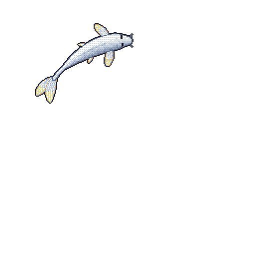

<p align="center">
  
</p>

<p align="center">
  <a href="https://github.com/JoSsArNaUd">
    
  </a>
</p>

---

## 🐳 `docker build -t josselin .`

Instead of a bio, here's the recipe:

```dockerfile
FROM switzerland/fribourg:bilingual

LABEL role="Engineering student" \
      school="HEIA-FR — School of Engineering and Architecture of Fribourg" \
      previously="Apprentice IT Technician (ICT-Berufsbildung Schweiz)"

WORKDIR /home/josselin

# front end by day...
RUN npm install vue nuxt typescript tailwindcss
# ...infrastructure by night
RUN apt-get install -y docker kubernetes ansible nginx

HEALTHCHECK CMD git push || exit 1
CMD ["learn", "build", "ship", "repeat"]
```

---

## 🧰 The stack (layer by layer)

| Layer | Tools |
| :-- | :-- |
| 🖋️ **Languages** |  |
| 🖌️ **Front end** |  <br>   |
| ⚙️ **Back end & runtime** |  <br>    |
| ☁️ **DevOps & cloud** |  <br>  |
| 🛠️ **Tooling** |  <br>   |
| 💻 **Systems** |  |

---

## 🌿 The pond

My contribution graph keeps two pets alive. The more I commit, the better they eat.

<p align="center">
  <picture>
    <source media="(prefers-color-scheme: dark)" srcset="https://raw.githubusercontent.com/JoSsArNaUd/JoSsArNaUd/output/github-contribution-grid-snake-dark.svg" />
    <source media="(prefers-color-scheme: light)" srcset="https://raw.githubusercontent.com/JoSsArNaUd/JoSsArNaUd/output/github-contribution-grid-snake.svg" />
    
  </picture>
</p>

<p align="center">
  
  <br>
</p>

---

## 📫 `EXPOSE 443`

<p align="left">
  <a href="https://www.linkedin.com/in/josselin-arnaud-1bb02b2b1">
    
  </a>
</p>

Thanks for stopping by. Ports are open, feel free to reach out !

<p align="center">
  
</p>
